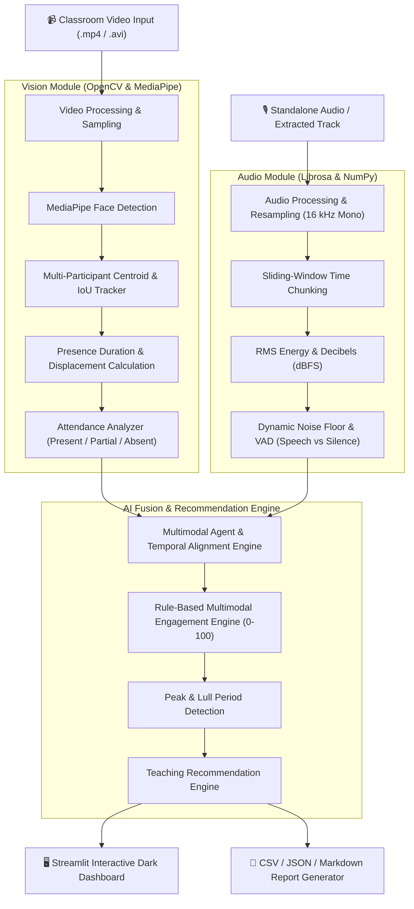

# Multimodal Attendance & Engagement Agent

[](https://www.python.org/)
[](https://streamlit.io/)
[](https://github.com/google/mediapipe)
[](https://librosa.org/)
[](https://plotly.com/)
[]()

> **An AI-powered multimodal classroom monitoring and analytics system that processes video and audio to track participant presence, estimate attendance, assess engagement dynamics, and deliver contextual pedagogical recommendations.**

---

## Table of Contents

1. [Project Overview](#1-project-overview)
2. [Problem Statement](#2-problem-statement)
3. [Key Objectives](#3-key-objectives)
4. [System Architecture](#4-system-architecture)
5. [Core Features](#5-core-features)
6. [Technology Stack](#6-technology-stack)
7. [Directory Structure](#7-directory-structure)
8. [Installation & Setup](#8-installation--setup)
9. [Running the Application](#9-running-the-application)
   - [Launching the Streamlit Web Dashboard](#launching-the-streamlit-web-dashboard)
   - [Command-Line Interface (Headless Runner)](#command-line-interface-headless-runner)
10. [End-to-End Workflow & Pipeline](#10-end-to-end-workflow--pipeline)
11. [Multimodal Fusion & Scoring Formula](#11-multimodal-fusion--scoring-formula)
12. [Teaching Recommendation Engine](#12-teaching-recommendation-engine)
13. [Sample Output & Report Formats](#13-sample-output--report-formats)
14. [Privacy, Ethical Considerations & Limitations](#14-privacy-ethical-considerations--limitations)
15. [College Viva & Interview Preparation Guide](#15-college-viva--interview-preparation-guide)

---

## 1. Project Overview

In traditional and smart classrooms, manual attendance is time-consuming and prone to inaccuracies, while passive video recordings fail to provide educators with actionable feedback regarding whether students remained engaged throughout the lecture.

The **Multimodal Attendance & Engagement Agent** solves this by fusing computer vision and acoustic signal processing to:
1. Detect and track participants across classroom video frames with consistent anonymous track IDs.
2. Calculate attendance based on cumulative visibility duration against configurable thresholds.
3. Extract and analyze acoustic signals for RMS energy, speech activity, silence, and background disturbance.
4. Fuse visual motion and acoustic indicators into a normalized, explainable engagement score (0–100).
5. Detect peak attentiveness phases and low-engagement lulls.
6. Synthesize context-aware pedagogical recommendations with exact session timestamps.
7. Present rich interactive analytics via a dark-themed Streamlit dashboard and exportable CSV/JSON reports.

The entire system operates **100% locally** on consumer hardware without requiring paid API keys or cloud connections.

---

## 2. Problem Statement

1. **Manual Attendance Overhead:** Taking attendance in large lecture halls consumes 10–15% of instructional time.
2. **Absence of Engagement Feedback:** Instructors often have no objective metrics to know when students lost focus, when a topic caused confusion, or when background room noise hampered listening comprehension.
3. **Privacy Concerns of Facial Recognition:** Many automated attendance systems attempt facial recognition database lookups that violate student data privacy. This project intentionally uses **anonymous track persistence** rather than biometric student identification.

---

## 3. Key Objectives

- **Visual Tracking:** Real-time multi-face detection using MediaPipe/OpenCV with IoU/centroid persistence across occlusions, movement, and camera angle variations.
- **Presence-Based Attendance:** Calculate exact presence duration (seconds) and percentage, classifying students into *Present*, *Partial*, or *Absent*.
- **Acoustic Intelligence:** Standardize audio to 16 kHz mono, divide into synchronized chunks, compute decibels (dBFS), estimate dynamic noise floors, and differentiate speech from ambient room noise.
- **Multimodal Fusion:** Synchronize temporal signals into uniform intervals and calculate explainable engagement scores with factor breakdowns.
- **Pedagogical Feedback:** Automatically identify extended silence, acoustic disturbances, or continuous engagement drops, generating constructive suggestions for instructors.
- **Professional Dashboard:** Interactive Plotly time-series charts, keyframe overlays, metric cards, and downloadable CSV/JSON exports.

---

## 4. System Architecture



---

## 5. Core Features

- **Anonymous Participant Tracking:** Detects multiple faces per frame; tracks individuals over time using centroid proximity, bounding-box smoothing, and an occlusion grace period.
- **Configurable Attendance Classification:** 
  - *Present:* $\ge 70\%$ presence
  - *Partial:* $35\% - 69.9\%$ presence
  - *Absent:* $< 35\%$ presence
  *(All thresholds can be adjusted in the UI or CLI).*
- **Acoustic Speech & Silence Analysis:** Automatically extracts audio track from video files using local tools, computes RMS energy, estimates dBFS levels, computes speech-to-silence ratios, and flags acoustic noise.
- **Multimodal Temporal Synchronization:** Slices session into synchronized 1-second time windows, mapping visual presence and movement against acoustic speech levels.
- **Transparent Engagement Engine:** Uses a weighted rule-based formulation that yields an explainable 0–100 score and classifies periods as *High*, *Moderate*, or *Low*.
- **Data-Driven Teaching Recommendations:** Flags extended lecture monologues, sudden engagement drops, and excessive background noise with exact timestamps and pedagogical rationales.
- **One-Click Demonstration:** Includes built-in synthetic classroom generators that synthesize test videos with moving students and realistic audio speech without requiring any external downloads.

---

## 6. Technology Stack

| Component | Library / Framework | Version | Purpose |
|---|---|---|---|
| **Language** | Python | 3.9 - 3.13 | Core runtime environment |
| **Computer Vision** | OpenCV (`opencv-python`) | $\ge 4.9.0$ | Video I/O, Haar cascade fallback, visual overlays |
| **Face Detection** | MediaPipe | $\ge 0.10.14$ | ML-based face detection in classroom frames |
| **Audio Processing** | Librosa / SoundFile / Scipy | Standard | Audio extraction, 16 kHz resampling, RMS dB, VAD |
| **Data Processing** | NumPy & Pandas | Latest | Array mathematics, timeline alignment, DataFrames |
| **Visualization** | Plotly & Matplotlib | $\ge 5.22.0$ | Interactive responsive time-series & distribution charts |
| **Web Dashboard** | Streamlit | $\ge 1.35.0$ | Modern dark-themed responsive user interface |
| **Testing** | Pytest | $\ge 8.0.0$ | Comprehensive unit & integration testing |

---

## 7. Directory Structure

```
multimodal-attendance-agent/
│
├── app.py                     # Streamlit interactive web application
├── main.py                    # Command-line runner for headless execution
├── requirements.txt           # Verified project dependencies
├── README.md                  # Comprehensive documentation and viva guide
├── .gitignore                 # Excludes venv, temp files, and caches
├── install_deps.py            # Fast installer utility forcing IPv4 socket resolution
│
├── modules/                   # Core intelligence modules
│   ├── __init__.py
│   ├── vision.py              # VisionAnalyzer & AttendanceAnalyzer (MediaPipe/OpenCV)
│   ├── audio.py               # AudioAnalyzer (RMS energy, dB, speech/silence ratios)
│   ├── engagement.py          # EngagementScoringEngine (rule-based fusion & timeline)
│   ├── multimodal_agent.py    # MultimodalAgent (synchronization & pipeline coordinator)
│   └── recommendations.py     # TeachingRecommendationEngine (pedagogical suggestions)
│
├── utils/                     # Helper functions
│   ├── __init__.py
│   ├── video_utils.py         # Video metadata, frame iteration, overlay & synthetic generator
│   ├── audio_utils.py         # Audio extraction, 16 kHz resampler & synthetic generator
│   ├── report_utils.py        # CSV, JSON, and Markdown report formatters
│   └── storage.py             # Session persistence, list, load, and delete
│
├── data/
│   ├── sample/                # Synthetic classroom video and audio test assets
│   └── reports/               # Persisted JSON session reports and exported CSVs
│
└── tests/                     # Automated test suite
    ├── __init__.py
    ├── test_vision.py         # Unit tests for tracking and presence logic
    ├── test_audio.py          # Unit tests for audio loading and VAD
    ├── test_engagement.py     # Unit tests for fusion formula and period detection
    └── test_pipeline.py       # End-to-end integration tests
```

---

## 8. Installation & Setup

### Prerequisites
- Python 3.9, 3.10, 3.11, 3.12, or 3.13 installed.
- VS Code, PyCharm, or terminal with PowerShell / Bash.

### Step 1: Clone or Navigate to the Project
```powershell
cd "c:\Users\HP\Desktop\MultiModel Attendance Project"
```

### Step 2: Create a Virtual Environment
```powershell
python -m venv .venv
```

### Step 3: Activate the Virtual Environment
**On Windows (PowerShell):**
```powershell
.venv\Scripts\Activate.ps1
```
*(If script execution is disabled in PowerShell, run `Set-ExecutionPolicy -Scope CurrentUser -ExecutionPolicy RemoteSigned` or use `.venv\Scripts\activate.bat` in Command Prompt).*

**On macOS / Linux:**
```bash
source .venv/bin/activate
```

### Step 4: Install Dependencies
```powershell
pip install -r requirements.txt
```

---

## 9. Running the Application

### Launching the Streamlit Web Dashboard

To launch the dark-themed interactive web interface:

```powershell
streamlit run app.py
```

The application will launch in your default web browser at `http://localhost:8501`.

#### Using the Dashboard:
1. **Overview:** View high-level session KPIs, engagement dynamics, and detection keyframes.
2. **Upload & Analyze:** Drag-and-drop a classroom video file (`.mp4`, `.avi`, `.mov`) or click **⚡ Use Sample Classroom Data** for an instant 1-click test.
3. **Attendance Records:** View per-participant presence duration, presence %, and download `attendance.csv`.
4. **Engagement Analytics:** Explore the interactive multi-line synchronized Plotly chart, review peak and lull periods, and download `engagement_timeline.csv`.
5. **Teaching Suggestions:** Read timestamped pedagogical recommendations with severity tags and rationales.
6. **Session Reports:** Download full JSON summaries or browse previously saved sessions from disk.

---

### Command-Line Interface (Headless Runner)

You can run the entire pipeline without opening a web browser using `main.py`:

#### 1. Quick Demonstration (Auto-generates sample classroom assets and runs pipeline):
```powershell
python main.py
```

#### 2. Analyze a Specific Classroom Video:
```powershell
python main.py --video "path/to/classroom_lecture.mp4"
```

#### 3. Analyze Video with a Separate High-Quality Audio File:
```powershell
python main.py --video "path/to/classroom.mp4" --audio "path/to/mic_audio.wav"
```

#### 4. Customize Attendance Thresholds:
```powershell
python main.py --video "video.mp4" --present-thresh 75.0 --partial-thresh 40.0
```

#### 5. List Previously Analyzed Sessions:
```powershell
python main.py --list-sessions
```

---

## 10. End-to-End Workflow & Pipeline

```
1. VIDEO / AUDIO INPUT
   └─ Upload classroom recording (.mp4, .avi, .wav) or load sample assets.

2. VISION MODULE (modules/vision.py)
   ├─ Sample frames at target FPS (e.g. 10 FPS).
   ├─ Detect faces via MediaPipe (with OpenCV cascade fallback).
   ├─ Centroid proximity & IoU tracking maintains consistent anonymous IDs.
   ├─ Calculate presence duration (seconds) and head/body displacement.
   └─ Classify attendance status (Present, Partial, Absent).

3. AUDIO MODULE (modules/audio.py)
   ├─ Extract audio stream locally via ffmpeg/moviepy into 16 kHz mono.
   ├─ Divide audio into fixed sliding windows (e.g. 1.0s chunks).
   ├─ Calculate RMS energy, decibels (dBFS), and zero-crossing rate.
   ├─ Compute dynamic noise floor and identify Speech vs Silence vs Noise.
   └─ Compute session speech-to-silence ratio.

4. MULTIMODAL TEMPORAL ALIGNMENT (modules/multimodal_agent.py)
   ├─ Synchronize frame metrics and audio chunks onto a uniform time grid.
   └─ Adaptively handle single-modality inputs (video-only or audio-only).

5. ENGAGEMENT SCORING & FUSION (modules/engagement.py)
   ├─ Apply weighted rule-based formulation (0–100 scale).
   ├─ Classify time intervals into High, Moderate, or Low.
   └─ Isolate peak engagement periods and low-activity drops.

6. TEACHING RECOMMENDATION ENGINE (modules/recommendations.py)
   ├─ Flag extended silence, sustained drops, or high noise.
   └─ Output timestamped pedagogical suggestions with clear rationales.

7. INTERACTIVE PRESENTATION & EXPORTS (app.py & utils/report_utils.py)
   ├─ Render Plotly charts, keyframe overlays, and metric cards.
   └─ Provide one-click downloads for CSV, JSON, and Markdown summaries.
```

---

## 11. Multimodal Fusion & Scoring Formula

Classroom engagement is estimated using a transparent, rule-based formula that combines observable physical indicators:

$$\text{Raw Score} = \left( W_{\text{presence}} \cdot R_{\text{presence}} \right) + \left( W_{\text{motion}} \cdot R_{\text{motion}} \right) + \left( W_{\text{speech}} \cdot R_{\text{speech}} \right) + W_{\text{base}} - P_{\text{noise}}$$

Where:
- $R_{\text{presence}} \in [0, 1]$: Fraction of participants visible in the frame relative to peak capacity.
- $R_{\text{motion}} \in [0, 1]$: Head and body displacement indicating alertness and responsive note-taking vs static frozen posture.
- $R_{\text{speech}} \in [0, 1]$: Acoustic confidence indicating active dialogue or instructor explanation.
- $W_{\text{base}} = 0.10$: Baseline attentiveness expectation.
- $P_{\text{noise}} \in [0, 0.15]$: Penalty applied if high ambient background noise or chaotic acoustic disturbance is detected.

The final score is clamped between 0 and 100:

$$\text{Engagement Score} = \max\left(0, \min\left(100, \text{Raw Score} \times 100\right)\right)$$

### Classification Intervals:
- **High Engagement:** $\ge 70$
- **Moderate Engagement:** $40 - 69.9$
- **Low Engagement:** $< 40$

---

## 12. Teaching Recommendation Engine

The recommendation engine evaluates session trends to assist instructors:

| Trigger Condition | Category | Severity | Actionable Pedagogical Suggestion |
|---|---|---|---|
| Engagement score drops below 38 for $>8$ seconds | **Interaction** | **Alert / Suggestion** | Prompt students with a quick poll, open-ended question, or think-pair-share exercise. |
| Speech is silent for $\ge 70\%$ of an extended session | **Pedagogy** | **Suggestion** | One-way monologue detected; introduce Socratic questioning or cold-call participants to stimulate dialogue. |
| Ambient noise ratio $\ge 35\%$ | **Acoustics** | **Alert** | High background disturbance detected. Check microphone proximity, HVAC noise, or room acoustics. |
| Overall participant attendance $< 50\%$ | **Presence** | **Suggestion** | Sub-optimal participant visibility. Verify camera field of view or check for student seat departure. |
| Sustained engagement $\ge 75$ for multiple intervals | **Pedagogy** | **Positive** | High student attentiveness observed. Note and replicate the instructional strategy used during this segment. |

---

## 13. Sample Output & Report Formats

### 1. Attendance Records (`attendance.csv`)
```csv
Participant ID,Presence Duration (s),Session Duration (s),Presence Rate (%),Attendance Status,First Seen (s),Last Seen (s)
Participant #1,12.0,12.0,100.0,Present,0.0,12.0
Participant #2,10.0,12.0,83.3,Present,0.0,12.0
Participant #3,4.0,12.0,33.3,Absent,0.0,6.0
```

### 2. Engagement Timeline (`engagement.csv`)
```csv
Timestamp (s),Window End (s),Engagement Score,Level,Visual Presence,Visual Activity,Audio Speech Score,Audio Noise Penalty,Explanation
0.0,1.0,78.5,High,1.0,0.65,0.70,0.0,Strong participant visibility; alert body/head responsiveness; active dialogue/discussion
1.0,2.0,81.2,High,1.0,0.72,0.80,0.0,Strong participant visibility; alert body/head responsiveness; active dialogue/discussion
...
```

### 3. Full Session JSON (`session_YYYYMMDD_HHMMSS.json`)
Contains all metadata, tracking records, chunk-by-chunk acoustic features, frame timelines, and recommendation objects for programmatic integration.

---

## 14. Privacy, Ethical Considerations & Limitations

1. **Anonymous Tracking by Default:** Face detection alone does not identify who a student is. The system assigns anonymous track IDs (`Participant #1`, `#2`) to preserve privacy and explicitly avoids biometric facial recognition databases unless separate consent is obtained.
2. **Engagement is a Proxy, Not Mind-Reading:** Observable physical signals (head nodding, facial presence, vocal participation) are correlated with attention, but cannot definitively measure internal cognition or learning comprehension.
3. **Camera & Environment Factors:** Occlusion, poor classroom lighting, or extreme camera angles can affect detection rates. The system includes an occlusion grace period to mitigate temporary head turns.

---

## 15. College Viva & Interview Preparation Guide

### Q1: What makes this system "multimodal"?
> **Answer:** It combines two independent physical modalities—**computer vision** (face detection, participant spatial tracking, displacement) and **acoustic signal processing** (RMS energy, dBFS decibels, voice activity detection). Combining both avoids the blind spots of single-modality systems (e.g., a student looking at the board during dead silence vs active interactive discussion).

### Q2: Why use MediaPipe over traditional Haar Cascades or CNNs?
> **Answer:** MediaPipe provides a lightweight BlazeFace architecture designed for mobile and edge devices that runs at high frame rates on CPU without requiring an expensive GPU, while offering superior detection accuracy under lighting changes and partial occlusions compared to Haar cascades.

### Q3: How do you handle tracking across frames without a deep re-identification model?
> **Answer:** We employ a spatial centroid and IoU tracker with exponential moving average smoothing for bounding boxes. To handle temporary occlusions (e.g., a student looking down to take notes), tracks are maintained across an occlusion grace window before being retired.

### Q4: How is audio synchronized with video?
> **Answer:** Audio is extracted and standardized to 16 kHz mono, then divided into fixed sliding windows (e.g. 1.0 second chunks). Each window's timestamp corresponds directly to the video timeline intervals, enabling uniform temporal alignment.

### Q5: Can the system run if audio or video is missing?
> **Answer:** Yes. The `MultimodalAgent` detects missing modalities gracefully. If video is absent, it executes acoustic engagement analysis; if audio is absent, it executes vision tracking and visual engagement without throwing errors.

---

## License

This project is open-source under the [MIT License](LICENSE). Built for college evaluation, Skill Wallet portfolios, and smart classroom analytics.
